# ISS Dashboard

Live ISS telemetry: the water tanks, cabin air, the solar arrays and a reboost alert.


The International Space Station sends its telemetry to the ground, and NASA publishes part of it. The front display shows a piece of it at a time: the station's three water tanks, the air in the cabin, the solar arrays turning. Turn the wheel to change what you look at; the back display lists all the numbers at once. When the station fires its engines to raise its orbit, an alert takes over the display.

A JavaScript app for [BUSY Bar](https://busy.app).

## What the bar shows

The app starts on the three tanks of Node 3 side by side: the urine, the waste water and the clean water, each with its level in percent and a bar filled to it.

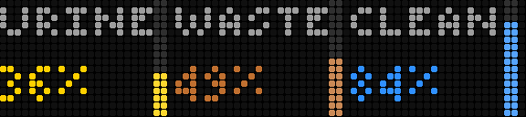

The wheel then shows each tank on the whole display, filled to its level, with its name and level over it. The urine is yellow and sloshes, with bubbles rising through it.

The waste water is a garbage heap.

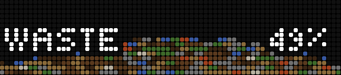

The clean water is blue and sloshes.

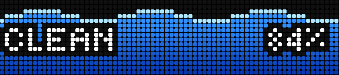

Cabin air in the US Lab: the temperature, the pressure and the CO2 partial pressure.

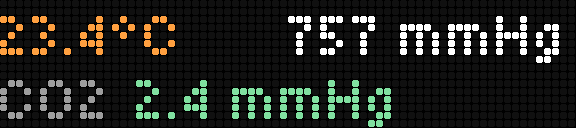

The solar arrays, seen from above the station as it flies up the display: the truss across, the modules along the middle, and the eight wings. Each wing gets shorter as its Solar Alpha Rotary Joint turns it away from the viewer and narrower as its Beta Gimbal turns it about its length, by the real joint angles. On the right is the beta angle, how far the Sun is out of the plane of the orbit.

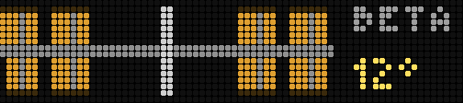

Between two updates the arrays keep turning at the rate they turned between the last two, when those were less than 20 minutes apart, and the view is redrawn every second. A rotary joint makes a turn in about an hour and a half, one orbit, so the wings change slowly; this GIF shows a little over four minutes in five seconds.


When the station's mode is Reboost, an alert with the station and its engine firing replaces any view. The first update that finds the reboost plays a sound and blinks the status light orange.

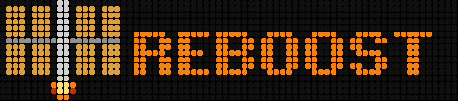

The back display lists every number: the three tanks, the states of the urine and the water processor, temperature, pressure, O2, N2, CO2, the beta angle, the station mode, and the age of the data, counted up from when the station sent it.

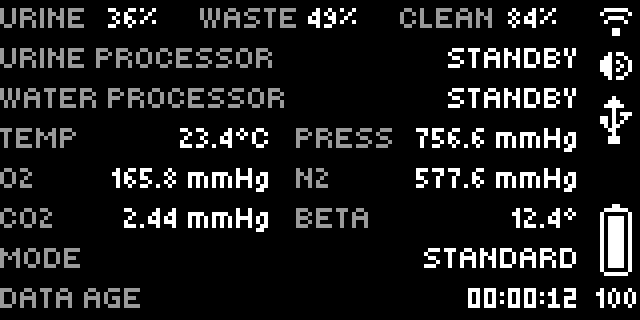


While the station is out of touch with the ground, the telemetry stands still. When an update brings telemetry sent more than a minute before it, the values are dimmed, the arrays stop, and the back display labels the age NO SIGNAL.

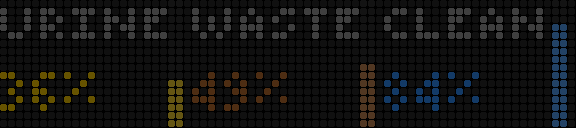


The last good update is kept on the bar and shown dimmed at the start until the first answer. When an update fails, the last values stay, dimmed, with a red cross in a corner of the front display, and the back display labels the age NO LINK.

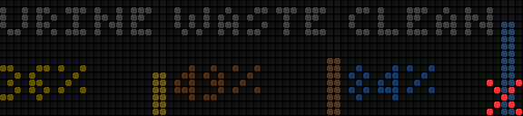

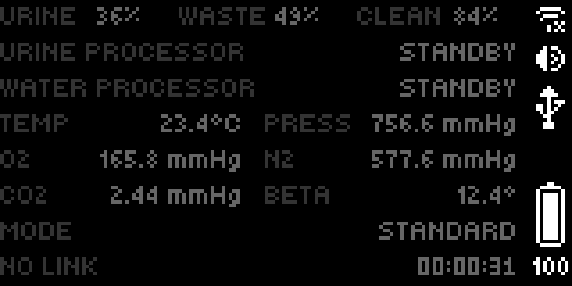

Without a connection and with nothing kept, every value is `--`, on the back display too.

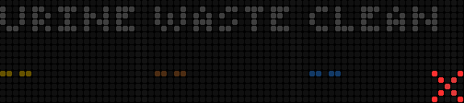

## Buttons

| Button | What it does |
| --- | --- |
| Wheel | Switches the view: the three tanks, the urine, the waste water, the clean water, cabin air, the solar arrays. |
| Back | Leaves the app. |

## Data

NASA's public ISS telemetry (ISSLIVE) from Lightstreamer's demo server, read over Lightstreamer HTTP requests every five minutes. The last good update is kept on the bar.

## Build

Node 24 and npm:

```sh
npm ci
npm run build         # dist/io.github.vvzvlad.iss.tgz
npm run app:install   # install it on a BUSY Bar connected over USB
npm run app:run       # start it
```

## License

[MIT](LICENSE)
